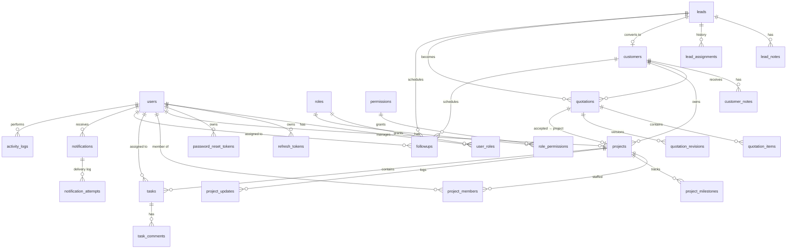

# THAMIZARA API

Business management backend for THAMIZARA Technologies.

- Node.js + Express (ES modules) · MySQL 8 via mysql2 · JWT + bcrypt · Zod
  validation · Nodemailer · Helmet · CORS allowlist · express-rate-limit · Pino

## Setup

```bash
npm install
cp .env.example .env      # fill in real values — never commit .env
npm run migrate up        # creates database + applies migrations
npm run dev               # nodemon on :4000  (npm start for production)
```

The app expects a dedicated MySQL user scoped to the `thamizora` database —
never the root account. The root account was only used once to create that
user locally; production should follow the same pattern with its own password.

## Commands

| Command | Purpose |
|---|---|
| `npm run dev` | Dev server (nodemon) |
| `npm start` | Production start (PM2 points here) |
| `npm run migrate up` | Apply pending migrations (creates DB if missing) |
| `npm run migrate down` | Roll back the latest migration batch |
| `npm run migrate status` | List applied / pending migrations |
| `npm run seed` | Initial SUPER_ADMIN + roles (Phase 4.2) |
| `npm run lint` | Oxlint |
| `npm test` | node:test suite |

## Conventions

- Base path `/api/v1`; response envelope `{ success, message, data, meta }`,
  errors `{ success, message, errors[] }`.
- Handlers use `asyncHandler`; throw `ApiError` — centralized
  `errorHandler` shapes the response and never leaks stack traces in prod.
- `validate(zodSchema)` strips unknown keys (mass-assignment protection).
- Money is `DECIMAL(14,2)`; currency is a stored ENUM (`XAF`/`NGN`/`USD`) —
  never converted server-side.
- Business records soft-delete (`deleted_at`); history/audit tables never
  cascade.
- Multi-step writes go through `withTransaction()`.

## Auth & RBAC (Phase 4.2)

- `POST /api/v1/auth/login` → `{ user, accessToken }` + `tmz_rt` httpOnly
  refresh cookie (path `/api/v1/auth`, `Secure` + `SameSite=None` in prod).
- `POST /api/v1/auth/refresh` — rotates the refresh token; reusing a rotated
  token revokes the whole token family and writes an audit event.
- `POST /api/v1/auth/logout`, `POST /api/v1/auth/logout-all` (bearer).
- `GET /api/v1/auth/me`, `PUT /api/v1/auth/change-password` (bearer; revokes
  all sessions on success).
- `POST /api/v1/auth/forgot-password` / `reset-password` — single-use hashed
  tokens, `PASSWORD_RESET_TTL_MINUTES` expiry, uniform response either way.
- `GET/POST/PUT/PATCH /api/v1/users...`, `PUT /users/:id/roles`,
  `GET /roles`, `GET /permissions` — all behind `requireAuth` +
  `requirePermission(...)`.
- Login throttling: per-endpoint rate limit **and** progressive account
  lockout (5 fails → 15 min, doubling to 24 h max).
- Guards: can't self-deactivate/self-re-role; only a SUPER_ADMIN can touch
  SUPER_ADMIN membership; last active SUPER_ADMIN can't be deactivated.
- First admin: `npm run seed:admin` (interactive hidden password or
  `--name/--email/--password` flags; refuses if a SUPER_ADMIN exists).

## Public enquiry API (Phase 4.3)

- `POST /api/v1/public/contact` — stores a `contact_form` lead (`NEW`),
  returns `LD-YYYY-NNNNN`. Zod-validated, honeypot field, publicLimiter.
- `POST /api/v1/public/quotation-requests` — transactionally creates the
  lead **and** a `REQUESTED` quotation (`QT-YYYY-NNNNN`) plus a customer
  status token (only its SHA-256 hash is stored).
- `GET /api/v1/public/quotation-status/:token` — customer-safe projection;
  amounts only appear once a quotation is `SENT`. Tokens expire after
  `STATUS_TOKEN_TTL_DAYS` (180 d default).
- **Idempotency**: `Idempotency-Key` header → `idempotency_keys` row
  (scope + key hash + payload hash). Replays return the stored response;
  same key + different payload → 409. 24 h retention, pruned on access.
- **Notifications**: `notifications` outbox + `notification_attempts`;
  `deliverPending()` runs after each enquiry and on a 60 s worker
  (`startNotificationWorker`). Customer ack + admin alerts, HTML+text
  templates. Failures never roll back stored enquiries.
- Frontend sends `VITE_API_BASE_URL` requests via `src/lib/api.js`;
  without it the site keeps its mailto/WhatsApp fallback.

## Simplified enquiry model (Phase 5)

The business runs a simple follow-up model — no emails/WhatsApp are sent
automatically; the team contacts customers manually.

**Public endpoints** (publicLimiter + idempotency + honeypot):

- `POST /api/v1/public/demo-requests` — `{name, email, phone, country,
  organization?, application, message?}` → `DR-YYYY-NNNNN`, status `NEW`,
  `submission_type = DEMO_REQUEST`. `application` must be one of the nine
  product options (see `DEMO_APPLICATIONS` in `public.schemas.js`).
- `POST /api/v1/public/enquiries` — `{name, email, phone?, country, category,
  message}` → `EN-YYYY-NNNNN`, `submission_type = GENERAL_ENQUIRY`.

**Admin inbox** (`/api/v1/admin/submissions`, `leads.read`/`leads.update`):

- `GET /` — filters `type status country category from to search`, pagination,
  allowlist sort.
- `GET /stats` — dashboard counts (totals + NEW/CONTACTED/COMPLETED/CANCELLED).
- `GET /:id` — full submission detail.
- `PATCH /:id/status` — `NEW→CONTACTED→COMPLETED`, `→CANCELLED` from any active
  state, `CANCELLED→NEW` reopen. Audited (`submission.status.changed`).

Both submission types are stored as `leads` rows with `submission_type` set —
the CRM leads module (Phase 4.4) continues to work untouched.

## CRM API — leads & customers (Phase 4.4)

**Leads** (`leads.*` permissions required):

- `GET /api/v1/leads` — paginated list. `search` (name/email/phone/whatsapp/
  business/reference), filters: `status country city serviceCategory source
  assignedTo from to`, safe sort allowlist (`sort`, `order`), `page`, `limit`.
- `GET /api/v1/leads/:id` — full record incl. notes, assignment history,
  linked quotations.
- `POST /api/v1/leads` (`leads.create`) — manual lead, `LD-YYYY-NNNNN`,
  status `NEW`.
- `PUT /api/v1/leads/:id` (`leads.update`) — partial update of enquiry fields.
- `PATCH /api/v1/leads/:id/status` (`leads.update`) — controlled transitions:
  `NEW→{CONTACTED,ON_HOLD,LOST}` · `CONTACTED→{QUALIFIED,ON_HOLD,LOST}` ·
  `QUALIFIED→{PROPOSAL_IN_PROGRESS,ON_HOLD,LOST}` ·
  `PROPOSAL_IN_PROGRESS→{QUALIFIED,ON_HOLD,LOST}` · `ON_HOLD→{NEW,CONTACTED,LOST}`
  · `LOST→{NEW}` · `CONVERTED` is terminal (only via `/convert`).
- `GET|POST /api/v1/leads/:id/notes` — internal notes (author + timestamp;
  never exposed publicly).
- `POST /api/v1/leads/:id/assign` (`leads.assign`) — target must be an ACTIVE
  user; writes `lead_assignments` history + audit.
- `GET /api/v1/leads/:id/activity` — audit trail for the lead.
- `POST /api/v1/leads/:id/convert` (`leads.convert`) — transactional, row-locked:
  * already converted → `already_converted` + existing customer (idempotent)
  * `customerId` given → `linked` to that customer
  * else duplicate candidates (email / phone / whatsapp / business+country) →
    `duplicate_candidates` for human review
  * else creates a `CU-YYYY-NNNNN` customer → `converted`
  Quotations gain `customer_id`; `lead_id` link is preserved.

**Customers** (`customers.*` permissions required):

- `GET /api/v1/customers` — `search`, `type`, `country` filters, sorting,
  pagination.
- `GET /api/v1/customers/:id` — profile + related leads/quotations/projects/notes.
- `POST /api/v1/customers` (`customers.create`) — manual customer.
- `PUT /api/v1/customers/:id` (`customers.update`) — partial update.
- `POST /api/v1/customers/:id/notes` — internal note.
- `GET /api/v1/customers/:id/activity` — customer + converted-lead audit trail.
- `GET /api/v1/customers/:id/leads` — leads converted into this customer.

## Entity relationships (Mermaid)



## Deployment (Phase 4.8 — planned, not yet executed)

Hostinger Ubuntu VPS → Nginx reverse proxy (`api.your-domain.com`) → PM2
(`npm start`, non-root user) → MySQL 8 on localhost (port 3306 not exposed).
Public site stays on Vercel; admin app deploys separately.
